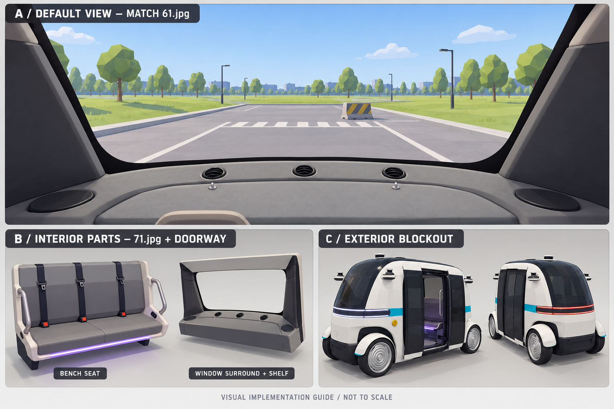

# Phase 3 구현용 설계 이미지



- 생성 방식: 내장 image_gen, 원본 사진 61/71/01/11을 참조하여 생성.
- A: 기본 시야 구현 목표. 61.jpg 원본을 우선하며 창·좌우 내장재·하단 선반 구도를 맞춘다.
- B: 좌석·손잡이·창 주변을 분리한 형상 참고. 부품의 나열은 실제 실내 배치를 뜻하지 않는다.
- C: 간단한 외관 형상 참고. 램프·센서·문·차체 비율은 생성 과정에서 변형되었으므로 원본 사진과 대조한다.
- 이미지 안의 공원·차로·횡단보도·장애물은 예시이며 실제 공원 지도나 추가 구현 요구사항이 아니다.
- 치수 도면·실측·정확한 투영도가 아니다. 구현 우선순위와 검증 조건은 PLAN.md를 따른다.
- A의 선반 점유율과 B의 상단 프레임 등 생성된 형상은 승인된 설계가 아니다. 충돌 시 61.jpg 및 PLAN.md가 우선한다.
- 빠른 구현 순서: A의 창 주변/선반과 카메라 → 개발 코스 → B/C 장식. 이미지 전체를 정밀 복제할 필요는 없다.

## 생성 프롬프트

```text
Use case: stylized-concept. Create a polished practical implementation reference board for a Rust Bevy low-poly autonomous shuttle simulator, landscape, high resolution. Use the provided photos as references only: image 1 (61.jpg) is the USER-APPROVED default first-person composition, image 2 (71.jpg) supplies bench seat details only, image 3 (01.jpg) supplies exterior and doorway details, image 4 (11.jpg) supplies the other exterior end. This is a new design board, not a photo edit.
Layout on clean warm light-gray background with precise panel borders, short legible English labels and no dense text:
Large top panel occupying 60 percent of board: 'A / DEFAULT VIEW — MATCH 61.jpg'. Low-poly game screenshot from inside shuttle, very closely match image 1's camera composition: broad clear panoramic window, thick dark inward sloping padded pillars at left and right, dark bottom window seal, gray shelf taking roughly bottom quarter, three small circular vents on shelf. No steering wheel, no driver's cockpit, no dashboard screens. Window center must remain clear and show a simple flat outdoor park training lane, grass, distant trees, stop line and one obstacle. No exhibition hall, people, logos, glass decals, photographic reflections or HUD overlays. Shelf and side pillars built with obvious simple shaded geometry for fast implementation. Neutral daylight and readable matte materials. Do not replace window opening with flat image.
Bottom row left panel: 'B / INTERIOR PARTS — 71.jpg + DOORWAY'. Separate isolated low-poly components on studio ground: a gray three-section bench with three seatbelts, pale outer shell, metal grab handles, small purple light accent; separately a simple window-surround and shelf assembly matching A. Do not invent their relative layout in a cabin or create a cutaway floorplan.
Bottom row right panel: 'C / EXTERIOR BLOCKOUT'. Small three-quarter low-poly reference model of same compact tall rounded shuttle: white body, large black glass canopy, turquoise side strip, four visible/implied corner wheels with white fenders, dark side door, minimal sensor-like silhouette based on photos. No brands, no elaborate sensor mechanisms.
Small footer text exactly 'VISUAL IMPLEMENTATION GUIDE / NOT TO SCALE'. Avoid numeric real-world dimensions or invented measurements. Style: consistent achievable Bevy game asset blockout, attractive professional 3D concept sheet rather than photorealism or futuristic redesign. Clear hierarchy, ample whitespace.
```